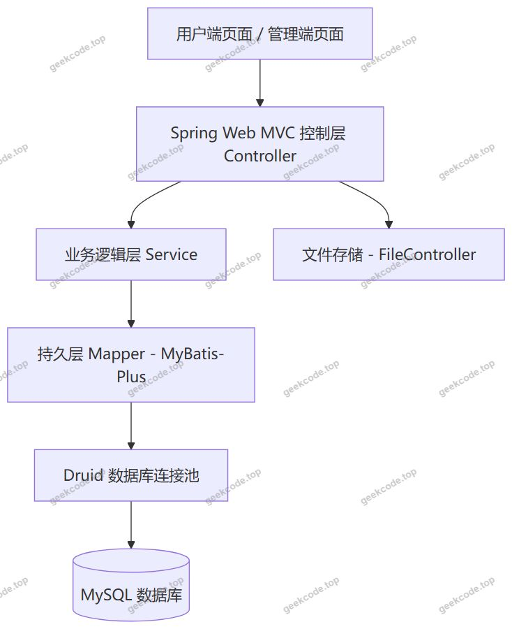
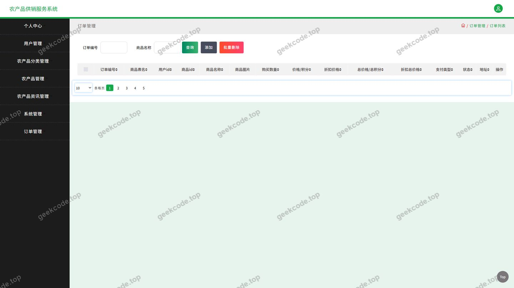
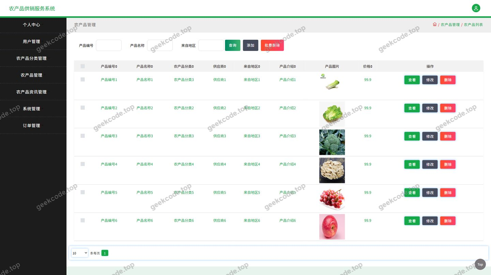
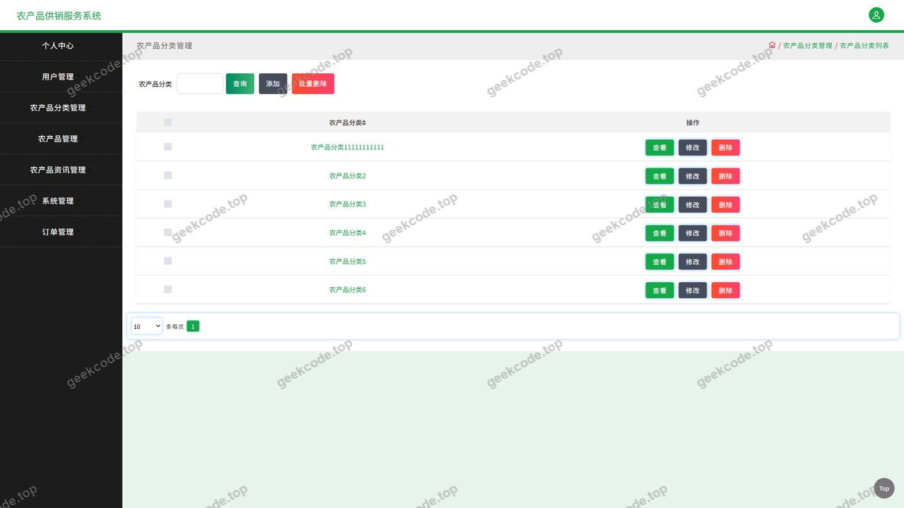
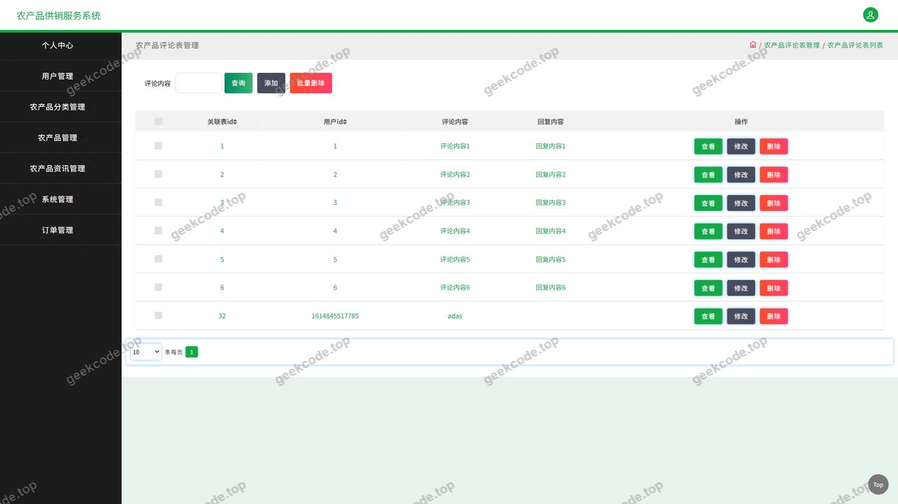
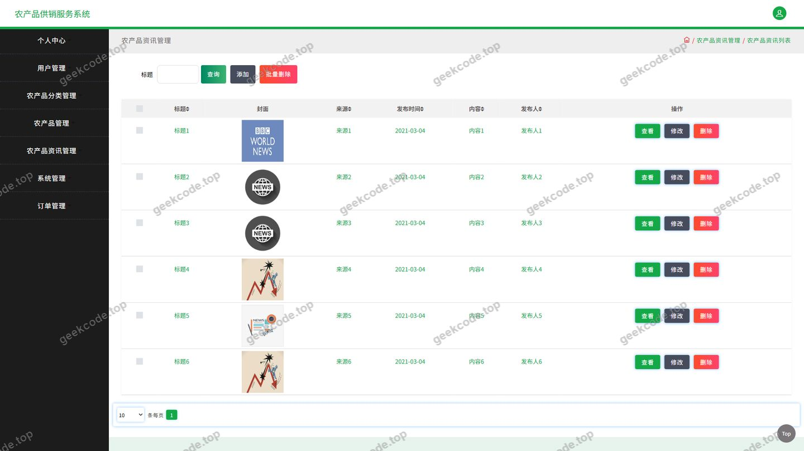
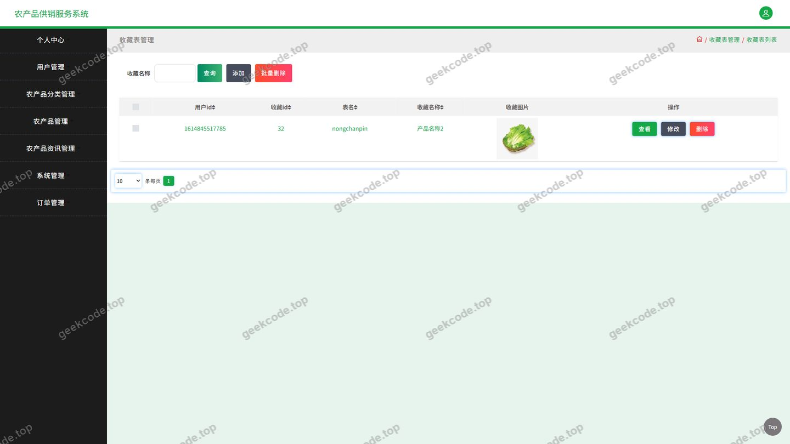
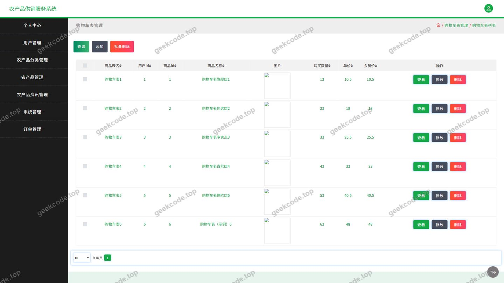
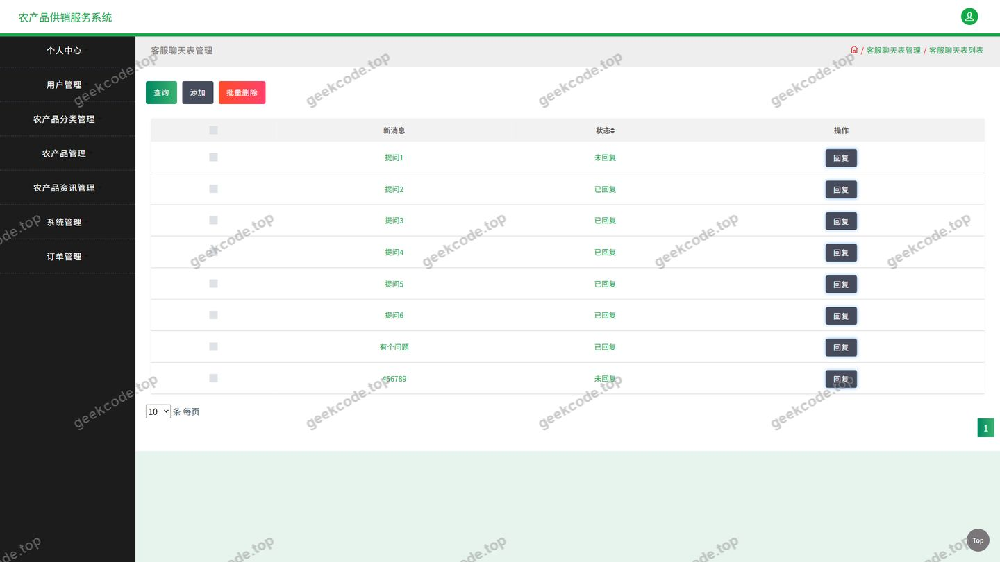

# java项目-ssm农产品供销服务系-ssm毕业设计-带论文

> 🎓 **计算机毕业设计 · java项目-ssm农产品供销服务系-ssm毕业设计-带论文**
>
> 本仓库只放**项目介绍 + 运行截图**（截图是站点带水印的原图，存在仓库 `images/` 里）。
>
> 👉 **完整可运行源码 / 数据库脚本 / 部署文档：[点我获取](https://geekcode.top/archives/java%E9%A1%B9%E7%9B%AE-ssm%E5%86%9C%E4%BA%A7%E5%93%81%E4%BE%9B%E9%94%80%E6%9C%8D%E5%8A%A1%E7%B3%BB-ssm%E6%AF%95%E4%B8%9A%E8%AE%BE%E8%AE%A1-%E5%B8%A6%E8%AE%BA%E6%96%87?utm_source=github)**
>
> 💬 咨询微信：**ir9372**　|　🌐 更多项目：[极客代码 geekcode.top](https://geekcode.top/?utm_source=github)
>
> 📌 项目详情页：<https://geekcode.top/archives/java%E9%A1%B9%E7%9B%AE-ssm%E5%86%9C%E4%BA%A7%E5%93%81%E4%BE%9B%E9%94%80%E6%9C%8D%E5%8A%A1%E7%B3%BB-ssm%E6%AF%95%E4%B8%9A%E8%AE%BE%E8%AE%A1-%E5%B8%A6%E8%AE%BA%E6%96%87?utm_source=github>

<table><td width="230" align="center"> <b>扫码加微信 ir9372</b></td><td valign="middle">📦 源码 = 项目介绍 + 全部运行截图 + 数据库 + 部署文档 👉 点上方任意截图，直接跳到 <b>极客代码 geekcode.top</b> 详情页</td></table>

---

<h1>java项目-ssm农产品供销服务系-ssm毕业设计-带论文</h1>
<h2>项目概述</h2>

本项目是一套面向农产品流通环节的供销服务系统，采用前后端分离的纯接口（pure-api）架构，后端以 Spring 为核心容器，结合 Spring Web MVC 提供 REST 风格接口，持久层采用 MyBatis-Plus 实现对象关系映射，数据源由 Druid 连接池统一管理。

系统核心功能围绕农产品的展示与交易展开：用户可浏览农产品与农产品资讯、按分类检索农产品、查看并评论农产品、加入购物车、下单购买、维护收货地址与收藏，并通过在线客服与平台沟通。管理侧通过用户管理、农产品管理、农产品分类管理、农产品资讯管理、订单管理、评论管理、收藏管理与系统配置等功能完成平台运营维护。

系统适用于农产品产地商户、农产品电商运营方以及有农产品线上采购需求的终端消费者，可作为中小型农产品供销平台的业务支撑系统，也可作为相关专业毕业设计的完整参考实现。

<h2>技术架构</h2>
<h3>整体架构</h3>

系统采用分层架构，客户端页面通过 HTTP 请求访问后端接口，后端按控制层、业务层、持久层逐层处理，最终由 Druid 连接池访问 MySQL 数据库。

<h3>控制层划分</h3>

系统接口按业务域拆分为若干控制器，职责边界清晰：

<table>
<thead>
<tr>
<th>控制器</th>
<th>职责</th>
</tr>
</thead>
<tbody><tr>
<td>AddressController</td>
<td>收货地址的增删改查</td>
</tr>
<tr>
<td>CartController</td>
<td>购物车条目的维护与查询</td>
</tr>
<tr>
<td>ChatController</td>
<td>在线客服会话与消息交互</td>
</tr>
<tr>
<td>CommonController</td>
<td>通用接口</td>
</tr>
<tr>
<td>ConfigController</td>
<td>系统配置信息读取与维护</td>
</tr>
<tr>
<td>DiscussnongchanpinController</td>
<td>农产品评论（讨论）数据管理</td>
</tr>
<tr>
<td>FileController</td>
<td>文件上传与下载</td>
</tr>
<tr>
<td>NongchanpinController</td>
<td>农产品信息管理</td>
</tr>
<tr>
<td>NongchanpinfenleiController</td>
<td>农产品分类管理</td>
</tr>
<tr>
<td>NongchanpinzixunController</td>
<td>农产品资讯管理</td>
</tr>
<tr>
<td>OrdersController</td>
<td>订单创建、查询与状态处理</td>
</tr>
<tr>
<td>StoreupController</td>
<td>收藏记录管理</td>
</tr>
</tbody></table>
<h3>数据库设计要点</h3>

数据模型围绕农产品供销主线组织，主要实体包括：用户、农产品、农产品分类、农产品资讯、订单、收货地址、购物车条目、收藏记录、农产品评论、客服会话消息以及系统配置项。农产品与农产品分类之间为归属关系，订单、购物车、收藏、评论均以用户和农产品为关联主体。具体表名与字段定义根据现有信息无法确定。

<h3>核心技术选型理由</h3>
<ul>
<li><strong>Spring / Spring Web MVC</strong>：项目依赖中包含 spring-core、spring-context、spring-context-support、spring-beans、spring-aop、spring-web、spring-webmvc、spring-tx、spring-jdbc，构成完整的容器、AOP、事务与 Web 请求处理能力，为分层开发提供基础支撑。</li>
<li><strong>MyBatis-Plus</strong>：在 MyBatis 基础上提供通用 CRUD 与条件构造能力，减少农产品、订单、收藏等高频数据表的重复 SQL 编写。</li>
<li><strong>Druid</strong>：作为数据库连接池，提供连接复用与监控能力，适配中小规模供销系统的并发访问特征。</li>
<li><strong>JUnit</strong>：用于单元测试，保障接口与业务逻辑的正确性。</li>
</ul>
<h2>功能模块</h2>
<h3>用户端功能模块</h3>
<ul>
<li><strong>登录</strong>：用户身份认证入口，登录后可访问个人中心相关功能。</li>
<li><strong>农产品</strong>：展示农产品列表与详情，是所有用户均可访问的核心浏览入口；用户可对农产品发表评论。</li>
<li><strong>农产品分类</strong>：按分类维度组织农产品，便于用户筛选与检索。</li>
<li><strong>农产品资讯</strong>：发布与展示农产品相关的行业资讯内容。</li>
<li><strong>个人中心</strong>：用户个人信息查看与维护。</li>
<li><strong>我的订单</strong>：查看订单记录与订单状态。</li>
<li><strong>我的地址</strong>：维护收货地址信息。</li>
<li><strong>我的收藏</strong>：管理已收藏的农产品记录。</li>
<li><strong>购物车</strong>：暂存待购买农产品，支持后续下单。</li>
<li><strong>在线客服</strong>：用户与平台之间的即时沟通渠道。</li>
</ul>
<h3>管理端功能模块</h3>
<ul>
<li><strong>用户管理</strong>：维护平台注册用户信息。</li>
<li><strong>农产品管理</strong>：农产品信息的录入、修改与下架。</li>
<li><strong>农产品分类管理</strong>：维护农产品分类体系。</li>
<li><strong>农产品资讯管理</strong>：发布与维护农产品资讯内容。</li>
<li><strong>订单管理</strong>：查看并处理平台订单。</li>
<li><strong>农产品评论管理</strong>：审核与管理农产品评论内容。</li>
<li><strong>收藏管理</strong>：查看平台收藏记录数据。</li>
<li><strong>系统配置管理</strong>：维护系统级配置参数。</li>
</ul>
<h2>用户角色与权限</h2>

系统按业务需要划分为三类角色：

<table>
<thead>
<tr>
<th>角色</th>
<th>可访问功能</th>
</tr>
</thead>
<tbody><tr>
<td>游客（未登录）</td>
<td>农产品列表与详情浏览、农产品分类浏览、农产品资讯浏览</td>
</tr>
<tr>
<td>注册用户</td>
<td>登录、农产品浏览与评论、农产品分类浏览、农产品资讯浏览、购物车、我的订单、我的地址、我的收藏、个人中心、在线客服</td>
</tr>
<tr>
<td>管理员</td>
<td>用户管理、农产品管理、农产品分类管理、农产品资讯管理、订单管理、农产品评论管理、收藏管理、系统配置管理、文件上传管理</td>
</tr>
</tbody></table>

注册用户通过登录接口完成身份认证后进入个人中心相关模块；管理员在管理端完成平台数据与配置的维护工作。

<h2>项目特色与创新点</h2>
<ul>
<li><strong>业务闭环完整</strong>：从农产品浏览、分类检索、收藏、加购、下单到地址维护，形成完整的农产品供销业务链路，覆盖用户从发现商品到完成交易的全过程。</li>
<li><strong>资讯与交易结合</strong>：在农产品交易功能之外集成农产品资讯模块，为平台提供内容运营能力，有助于提升用户停留与复访。</li>
<li><strong>评论与客服双通道</strong>：通过农产品评论与在线客服两条通道，同时满足用户公开反馈与私密咨询的需求。</li>
<li><strong>收藏沉淀用户行为</strong>：StoreupController 提供的收藏能力可沉淀用户兴趣数据，为后续个性化推荐提供数据基础。</li>
<li><strong>接口分层清晰</strong>：控制器按业务域拆分，配合 MyBatis-Plus 与 Druid，便于后续横向扩展模块。</li>
</ul>
<h2>部署环境</h2>
<table>
<thead>
<tr>
<th>类别</th>
<th>要求</th>
</tr>
</thead>
<tbody><tr>
<td>开发语言</td>
<td>Java</td>
</tr>
<tr>
<td>运行环境</td>
<td>JDK</td>
</tr>
<tr>
<td>应用容器</td>
<td>支持 Spring Web MVC 的 Servlet 容器</td>
</tr>
<tr>
<td>数据库</td>
<td>MySQL</td>
</tr>
<tr>
<td>连接池</td>
<td>Druid</td>
</tr>
<tr>
<td>持久层框架</td>
<td>MyBatis-Plus</td>
</tr>
<tr>
<td>核心框架</td>
<td>Spring、Spring Web MVC、Spring JDBC、Spring AOP、Spring TX</td>
</tr>
<tr>
<td>构建与依赖管理</td>
<td>Maven（依据标准 Java 工程依赖组织方式）</td>
</tr>
<tr>
<td>单元测试</td>
<td>JUnit</td>
</tr>
</tbody></table>

前端页面若为独立部署的静态资源，需由 Web 服务器或 Servlet 容器托管；根据现有信息无法确定前端构建工具链。

<h2>五、技术特性</h2>
<ul>
<li>使用 MyBatis-Plus 简化数据访问层开发</li>
</ul>
<h2>六、功能模块截图</h2>
<h3>后台管理端</h3>
<h4>页面-登录</h4>

<h4>页面-订单</h4>

<h4>页面-农产品</h4>

<h4>页面-农产品分类</h4>

<h4>页面-农产品评论</h4>

<h4>页面-农产品资讯</h4>

<h4>页面-收藏</h4>

<h4>页面-用户</h4>

<h4>页面-在线客服</h4>

---

## 获取完整源码

| 项目 | 说明 |
| --- | --- |
| 项目名 | java项目-ssm农产品供销服务系-ssm毕业设计-带论文 |
| 运行截图 | 本文 10 张（站点带水印原图，仓库 `images/` 目录） |
| 完整源码 | [https://geekcode.top/archives/java%E9%A1%B9%E7%9B%AE-ssm%E5%86%9C%E4%BA%A7%E5%93%81%E4%BE%9B%E9%94%80%E6%9C%8D%E5%8A%A1%E7%B3%BB-ssm%E6%AF%95%E4%B8%9A%E8%AE%BE%E8%AE%A1-%E5%B8%A6%E8%AE%BA%E6%96%87?utm_source=github](https://geekcode.top/archives/java%E9%A1%B9%E7%9B%AE-ssm%E5%86%9C%E4%BA%A7%E5%93%81%E4%BE%9B%E9%94%80%E6%9C%8D%E5%8A%A1%E7%B3%BB-ssm%E6%AF%95%E4%B8%9A%E8%AE%BE%E8%AE%A1-%E5%B8%A6%E8%AE%BA%E6%96%87?utm_source=github) |
| 咨询微信 | **ir9372**（备注：jingpin-yuanma） |
| 更多项目 | [极客代码 geekcode.top](https://geekcode.top/?utm_source=github) |

> 需要源码、部署、改配置、跑不起来等问题，加微信 ir9372 沟通，说明项目名即可。
